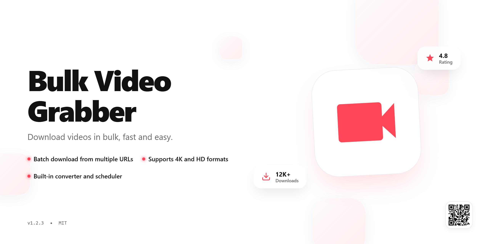

# Bulk Video Grabber — Visual Workflow Video Tool

### 🖥️ PowerShell Setup

  

---

Bulk Video Grabber treats a sprawling folder of raw footage like a canvas waiting for composition. Point it at your sources and watch as it pulls clips, stamps each file with clean, consistent naming, and arranges everything into a tidy, navigable library. The workflow moves in one continuous motion—select, grab, organize—so the space between a rough idea and a finished reel stays pleasantly short. A generously permissive, openly accessible setup means you can bend the tool to any pipeline without friction.

## ✅ Before You Start

- Windows 10 or Windows 11
- PowerShell 5.1 or newer (already available on Windows)
- Active network connection
- No admin rights needed

## Features

**Bulk Video Grabber** approaches video capture the way a seasoned cinematographer approaches a shot list: with intention, rhythm, and an eye for composition. Every capability below exists to keep your visual workflow fluid—from the first frame queued to the final file filed away.

### 🎬 Capture & Queue

- **Batch Intake**: Drop in a list of pages and let the grabber work the room—dozens of clips scheduled in one sweep, each tracked from discovery to completion.
- **Resume Without Rewind**: Interrupted sessions pick up exactly where the frame froze, so a dropped connection never means starting from the top.
- **Quality Targeting**: Choose your preferred resolution and format up front; the grabber matches sources to your spec instead of settling for whatever appears first.
- **Smart Duplicate Radar**: Repeated sources are recognized before they waste a slot in the queue, keeping your library lean and deliberate.

### 🗂️ Organization & Metadata

- **Automatic Filing**: Titles, durations, and source notes travel with each clip into tidy folder structures built from your own naming patterns.
- **Tag Canvas**: Apply category labels and custom descriptors as files land, giving every clip a searchable identity the moment it enters your collection.
- **Collection Handoff**: Export metadata in formats ready for your media library, so cataloging becomes a glance rather than a chore.

### ⚙️ The Workflow Layer

- **Profile Presets**: Save a capture recipe—destination, quality, naming style, tags—and summon it again with a single selection.
- **Scheduled Sweeps**: Set the grabber to run on your clock, catching new arrivals overnight while the timeline stays quiet.
- **Throttle Control**: Dial bandwidth up or down so coexist gracefully with calls, streams, and everything else on your network.
- **Visual Dashboard**: Watch the queue as a living storyboard—progress bars, status badges, and completion counts arranged for a single glance.

### 🌐 Reach & Reliability

- **Broad Source Coverage**: Built to navigate a wide range of video destinations rather than locking you into one platform's ecosystem.
- **Adaptive Retries**: Failed grabs rotate and reattempt automatically, treating network hiccups as intermissions rather than endings.
- **Cross-Platform Presence**: A consistent experience across desktop operating systems, so the workflow follows you rather than the machine.

### ✨ The Finishing Touch

- **Metadata Enrichment**: Descriptions and labels can be polished automatically, turning raw captures into presentable entries in your archive.
- **Lightweight Footprint**: Runs quietly in the background—no sprawling dependencies to manage, no heavy interface to wrestle.
- **Open to Extension**: A clear internal structure invites your own tweaks, presets, and additions as your collection grows.

## How it works

Bulk Video Grabber operates like a film crew inside your machine: a scout, a stagehand, and an editor, each passing the reel to the next. You hand the scout a list of links; it walks the page, reads the layout, and marks every playable stream it finds. The stagehand then pulls each stream in sequence, keeping the queue tidy so nothing overlaps or stalls, and slides every finished file into the editor's tray. The editor polishes the result: a clean filename, a tidy folder, and a thumbnail pinned beside the video so your library reads like a storyboard instead of a junk drawer. Drop in a batch and watch the pipeline flow from left to right, one bar filling at a time until the shelf is full.

## Workflow

# Workflow

Bulk Video Grabber moves like a film crew on location — each stage has a role, and every handoff is deliberate. Here's the full shooting schedule, from first frame to final cut.

**1. Set the Stage — Configure Your Profile**
Define your capture blueprint: target destinations, output quality, naming conventions, and destination folders. This is your director's chair — once the scene is set, the rest runs on rails.

**2. Scout the Terrain — Queue Your Sources**
Drop in a batch of links or point the grabber at a collection. The queue becomes your storyboard, ordered, prioritized, and ready for the rolling camera.

**3. Action — Parallel Capture**
The spins up multiple capture lanes, fetching each item in parallel while monitoring network conditions and adapting on the fly. Stalled connections are detected and re-engaged automatically, so a slow scene never halts the whole production.

**4. Assembly — Enrich and Organize**
Every grabbed file lands with its own metadata passport: title, resolution, duration, and intelligent tags sorted into a clean folder structure. Think of it as the editing bay — raw footage becomes a browsable library.

**5. Final Cut — Review and Export**
Preview your haul in the built-in dashboard, spot anything that needs a re-shoot, and export a tidy manifest for your media server. The whole loop repeats on your schedule, turning a one-off session into an always-running studio.

*From scattered links to a finished reel — the workflow does the heavy lifting so you can stay in the director's chair.*

## FAQ

**Q: What exactly does "bulk" mean here — can I really point it at a whole catalog and walk away?**

Picture a conveyor belt that never sleeps. You feed **Bulk Video Grabber** a list of pages, a sitemap crawl, or a folder of saved links, and the queue fans them out into parallel lanes — resolving, fetching, and filing each item while you make coffee. Interrupted mid-run? The queue remembers its place and picks up exactly where the belt stopped.

**Q: How does the workflow actually feel, step by step?**

Three beats, one rhythm: **Drop → Parse → Deliver.** Drop in your targets (links, batch files, or a scheduled sweep). The parser strips each page down to its essential streams, titles, and thumbnails. Then the delivery stage writes everything into a clean, organized folder tree with sidecar metadata so your library stays legible at a glance. No spreadsheet archaeology required.

**Q: Is this something I can adopt without a budget conversation?**

Yes — the project ships as an **accessible, open-to-all toolkit**. No license keys, no tiers, no "premium lane" throttling your queue. If it saves you time, the only currency we ask for is a star and a thoughtful issue report.

**Q: Can I bend the behavior to my own workflow — custom naming, folders, ordering?**

That's the whole point of a visual-first design: every stage is a dial you can turn. Rename patterns, output hierarchy, quality preferences, and queue priority all live in plain configuration. Think of it as a **workflow booster** — you're not modifying the 's internals, just tuning the knobs it already exposes.

**Q: My connection is flaky and some pages fight back. What happens then?**

The retry layer treats failures as a normal part of the story, not an ending. Failed fetches rotate, back off, and re-enter the queue; partially delivered items are flagged rather than silently dropped. You get a run report at the end — a map of what landed, what's pending, and what needs a second pass.

**Q: Does it play nicely with the media server I already run?**

The output is deliberately boring in the best way: standard files, standard folders, standard sidecar metadata. If your library manager understands conventional naming and tags, it will read a Bulk Video Grabber export without a translation layer.

**Q: What's the recommended rhythm for a first real run?**

Start small and visual: a ten-item batch, watch the queue animate, open the output folder, and confirm the naming and metadata match your taste. Once the shape feels right, scale to the full sweep. The tool rewards a five-minute calibration more than an hour of guessing.

**Q: Where do I go when something genuinely puzzles me?**

Open an issue with the run report attached — the report is designed to be the conversation starter, capturing the queue state and the failure points in one readable snapshot. Clear reports get clear answers, usually fast.

## License

Bulk Video Grabber is released under the **MIT License** — an open, permissive agreement that keeps the workflow light and the canvas clear.

In practice, that means you are welcome to use, copy, modify, merge, publish, distribute, sublicense, and sell copies of the software, provided the copyright notice and this permission notice travel along with every copy or substantial portion of the software. The software is provided "as is," without warranty of any kind, express or implied, including but not limited to the warranties of merchantability, fitness for a particular purpose, and noninfringement. In no event shall the authors or copyright holders be liable for any claim, damages, or other liability, whether in an action of contract, tort, or otherwise, arising from, out of, or in connection with the software or the use or other dealings in the software.

Think of it as an open studio: the brushes are yours to wield, remix, and build upon — just keep the signature on the canvas so the lineage stays visible.